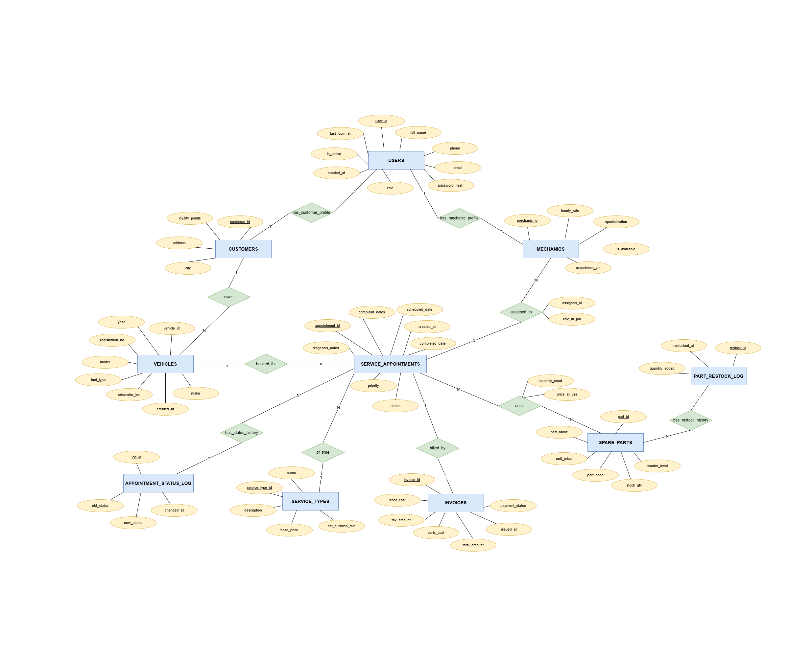
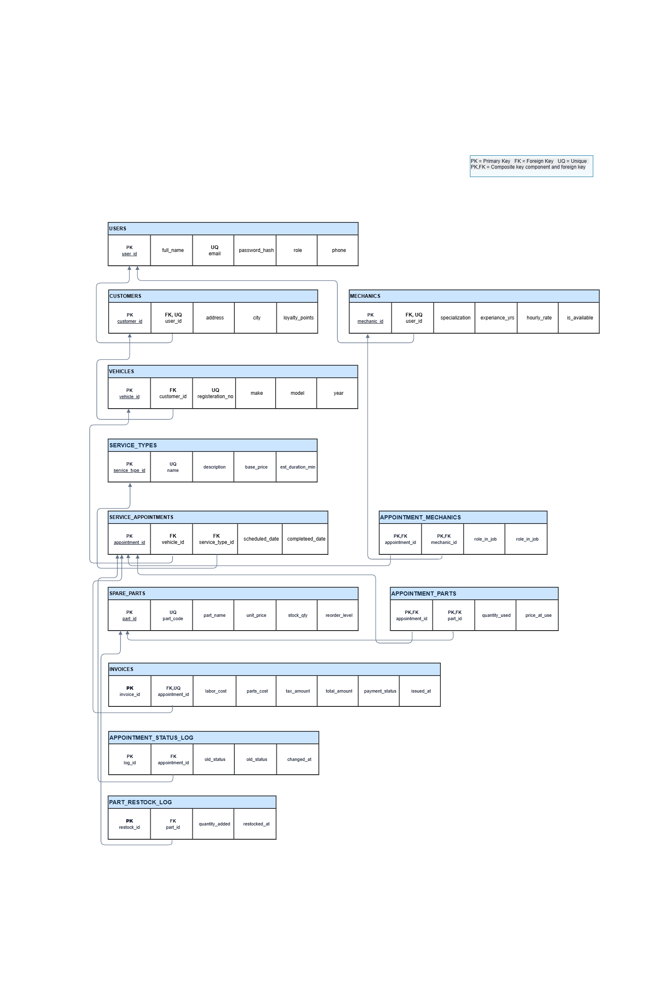
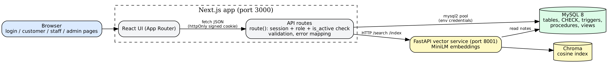

# AutoCare — Vehicle Service & Maintenance Management System
## Project Documentation (DBMS Level 3 Project)

**Database option chosen: Option 2 — SQL (MySQL, mandatory) + Vector Database (Chroma).**
Team of 2. Stack: Next.js 16 (UI + API route handlers) · MySQL 8 · Chroma via a small FastAPI service · Git/GitHub.

Contents: 1 Problem statement · 2 Objectives · 3 Scope · 4 Functional requirements · 5 Database choice and justification ·
6 ER diagram · 7 Relational schema · 8 Entities, keys, relationships, constraints · 9 SQL implementation · 10 Vector database design ·
11 Important queries · 12 System architecture · 13 Application screenshots · 14 Testing results · 15 Conclusion and future enhancements

---

## 1. Problem statement

Independent vehicle service centres usually run on paper or disconnected spreadsheets. That causes duplicate data entry, no
visibility into which mechanic is overloaded or double-booked, stock-outs discovered mid-job, billing mistakes, and no way to learn
from past diagnoses: when a customer describes a fault in new words ("screech when slowing down"), staff cannot find the earlier job
that was "squeaking noise when braking", because keyword search only matches shared vocabulary.

AutoCare puts customers, vehicles, appointments, mechanics, spare parts and billing in one relational database, enforces the business
rules inside the database, and adds a vector index over the free-text complaint/diagnosis notes so staff can retrieve similar past
cases by meaning.

## 2. Objectives

- One source of truth for customers, vehicles, mechanics, parts, appointments and invoices.
- Enforce integrity in the database itself (keys, CHECKs, triggers, procedures), not only in application code.
- Automate bookkeeping: stock deduction, invoice totals, loyalty points, status history.
- Role-based web application for customers, mechanics (staff) and admins.
- Semantic retrieval of similar past issues, justified against plain keyword search.

## 3. Scope

**In scope:** relational schema, DDL/DML, views, stored procedures and a function, triggers, transactions, indexes and FULLTEXT;
Chroma semantic search; Next.js web application with authentication and three roles; API layer; documentation and tests.

**Out of scope:** online payment gateway, SMS/e-mail notifications, multi-branch support, mobile app.

## 4. Functional requirements

| ID | Requirement | Role |
|---|---|---|
| F1 | Register, sign in, sign out; passwords stored as bcrypt hashes; sessions via signed httpOnly cookie | all |
| F2 | Add / update odometer / delete own vehicles | customer |
| F3 | Book a service appointment with complaint text; cancel while scheduled | customer |
| F4 | View own appointments, invoices; pay an invoice | customer |
| F5 | See assigned jobs; start a job; record diagnosis; add / remove parts used; finish job (invoice generated) | mechanic |
| F6 | View stock levels and low-stock parts | mechanic, admin |
| F7 | Search similar past issues (semantic, keyword, hybrid) | mechanic, admin |
| F8 | Dashboard KPIs; manage all appointments; assign mechanics (double-booking blocked); cancel | admin |
| F9 | Billing: list invoices, mark paid (loyalty points awarded) | admin |
| F10 | Inventory: add parts, restock, remove unused parts | admin |
| F11 | User management: create staff, activate / deactivate accounts | admin |
| F12 | 12 whitelisted analytical reports (revenue per month, mechanic workload, top parts, …) | admin |
| F13 | Rebuild the vector index from MySQL | admin |

## 5. Database choice and justification

| Data | Paradigm | Why |
|---|---|---|
| Customers, vehicles, appointments, parts, invoices, users | **MySQL (relational)** | Highly structured and interrelated (foreign keys); stock deduction + billing must be atomic (transactions); precise aggregates needed (revenue, workload). |
| Complaint / diagnosis free text | **Chroma (vector)** | Unstructured language: two descriptions of one fault can share almost no words. A sentence embedding captures meaning, so similar past cases are found regardless of phrasing. FULLTEXT cannot do this. |

The structured data stays relational because it benefits from constraints and joins; only the free-text moves to a vector store, and the
vector store keeps just ids + metadata so MySQL remains the source of truth. The Search page lets a user run the same query with Semantic,
Keyword and Hybrid modes to demonstrate the difference.

## 6. ER diagram



Chen notation. `users` is specialised into `customers` and `mechanics` by 1:1 profile tables. The two M:N relationships (`assigned_to`,
`uses`) carry their own attributes and become junction tables in the relational schema.

## 7. Relational schema



Textual form (PK underlined in the diagram; FK → referenced table):

```
users(user_id PK, full_name, email UQ, password_hash, role, phone, is_active, created_at, last_login_at)
customers(customer_id PK, user_id FK→users UQ, address, city, loyalty_points)
mechanics(mechanic_id PK, user_id FK→users UQ, specialization, hourly_rate, is_available)
vehicles(vehicle_id PK, customer_id FK→customers, registration_no UQ, make, model, year, fuel_type, odometer_km, created_at)
service_types(service_type_id PK, name UQ, description, base_price, est_duration_min)
spare_parts(part_id PK, part_name, part_code UQ, unit_price, stock_qty, reorder_level)
service_appointments(appointment_id PK, vehicle_id FK→vehicles, service_type_id FK→service_types, scheduled_date, completed_date,
                     status, priority, complaint_notes, diagnosis_notes, created_at)
appointment_mechanics(appointment_id PK,FK→service_appointments, mechanic_id PK,FK→mechanics, role_in_job, assigned_at)
appointment_parts(appointment_id PK,FK→service_appointments, part_id PK,FK→spare_parts, quantity_used, price_at_use)
invoices(invoice_id PK, appointment_id FK→service_appointments UQ, labor_cost, parts_cost, tax_amount, total_amount, payment_status, issued_at)
appointment_status_log(log_id PK, appointment_id FK, old_status, new_status, changed_at)      -- audit, written by trigger
part_restock_log(restock_id PK, part_id FK, quantity_added, restocked_at)                      -- audit, written by procedure
```

Normalisation: all tables are in 3NF. M:N relationships are resolved through junction tables; `price_at_use` deliberately snapshots the part
price at time of use so later price changes do not alter past invoices.

## 8. Entities, keys, relationships and constraints

Column-level detail is in `DATA_DICTIONARY.md`.

**Relationships:** users 1—0..1 customers; users 1—0..1 mechanics; customers 1—N vehicles; vehicles 1—N appointments;
service_types 1—N appointments; appointments 1—1 invoices; appointments M—N mechanics; appointments M—N spare_parts.
Foreign keys use `ON UPDATE CASCADE` and either `RESTRICT` (financial / ownership data) or `CASCADE` (dependent rows and logs).

**Constraints:**
- NOT NULL, DEFAULT, UNIQUE (`email`, `registration_no`, `part_code`, `service_types.name`, `invoices.appointment_id`).
- ENUMs: user role, appointment status, priority, fuel type, payment status.
- CHECKs: `chk_users_phone`, `chk_loyalty_nonneg`, `chk_hourly_rate`, `chk_vehicle_year` (1950–2100), `chk_service_price`,
  `chk_part_price`, `chk_stock_nonneg`, `chk_appt_dates` (completed ≥ scheduled), `chk_qty_positive`, `chk_amounts_nonneg`, `chk_restock_qty`.
- Triggers enforcing rules CHECK cannot express (see §9).

## 9. SQL implementation

| File | Contents |
|---|---|
| `01_schema.sql` | DROP DATABASE IF EXISTS, CREATE DATABASE/TABLE, PK/FK, constraints, indexes, FULLTEXT |
| `02_sample_data.sql`, `10_extra_sample_data.sql` | INSERT sample data |
| `03_views.sql` | `vw_service_history`, `vw_mechanic_workload`, `vw_low_stock_parts`, `vw_revenue_by_service` |
| `04_procedures.sql` | `sp_book_appointment`, `sp_complete_appointment_and_bill`, function `fn_customer_lifetime_spend` |
| `05_triggers.sql` | `trg_deduct_stock_after_part_use`, `trg_check_stock_before_part_use`, `trg_restore_stock_after_part_delete`, `trg_award_loyalty_on_payment` |
| `06_transactions_demo.sql` | COMMIT demo and ROLLBACK demo (atomicity) |
| `07_queries.sql` | 12 queries (see §11) |
| `08_alter_and_extensions.sql` | ALTER TABLE (priority, last_login_at, CHECK), DROP INDEX / CREATE INDEX, two audit tables, triggers `trg_log_appointment_status`, `trg_prevent_mechanic_double_booking`, `trg_vehicle_odometer_no_rollback`, view `vw_dashboard_kpis` |
| `09_app_procedures.sql` | 10 procedures used by the API: register customer, create staff, assign mechanic, start / finish job, add / remove part, cancel, pay invoice, restock |
| `00_install_all.sql` | runs everything in the right order |

**Advanced features demonstrated (8 of the listed concepts; 4 required):** transactions, views, stored procedures/functions, triggers,
indexing, full-text search, vector similarity search, and the application's use of transactions inside procedures.

**DDL coverage:** CREATE, ALTER, DROP (tables, indexes), PK/FK, constraints, indexes, views.
**DML coverage:** INSERT, UPDATE, DELETE, SELECT through both the SQL files and the application's API.

## 10. Vector database design (Chroma)

| Aspect | Design |
|---|---|
| Collection | `service_notes` (one collection, persistent local store `vector/chroma_data/`) |
| Document | one per appointment that has a complaint: `"<service name>. <complaint_notes>. <diagnosis_notes>"` |
| Document id | `appointment_id` as a string (primary key link back to MySQL) |
| Metadata | `appointment_id`, `registration_no`, `vehicle` ("Make Model"), `service_name`, `status` |
| Embedding model | `all-MiniLM-L6-v2` sentence-transformer (384 dimensions, ONNX via Chroma's default function); vectors computed in the service and passed to Chroma |
| Fallback | TF-IDF (scikit-learn) only if the model cannot be downloaded; `/health` and the UI flag it as `degraded` because it matches words, not meaning |
| Index | HNSW approximate-nearest-neighbour index, **cosine** distance set explicitly (`hnsw:space = cosine`) |
| Similarity | `similarity = 1 − cosine_distance`; hits below `MIN_SIMILARITY` (default 0.2) are discarded |
| Retrieval | query text → embed → top-k nearest → join the returned `appointment_id`s to `vw_service_history` in MySQL for full context |
| Hybrid mode | vector top-20 and MySQL FULLTEXT top-20 merged with reciprocal-rank fusion |
| Freshness | `POST /index/{id}` after an appointment is booked or its diagnosis changes; `POST /reindex` rebuilds from MySQL |
| Interface | FastAPI on 127.0.0.1:8001: `/health`, `/search`, `/index/{id}`, `/reindex`; optional shared-secret header |

MySQL remains the source of truth: Chroma can be deleted and rebuilt at any time. If the vector service is down, the API falls back to
FULLTEXT and tells the user.

## 11. Important queries (`sql/07_queries.sql`)

| # | Purpose | Concepts |
|---|---|---|
| Q1 | Vehicles of a customer | JOIN |
| Q2 | Revenue per month | aggregate, GROUP BY, ORDER BY |
| Q3 | Mechanics with more than one completed job | GROUP BY, HAVING |
| Q4 | Customers spending above the average | subquery |
| Q5 | Vehicles never serviced | correlated NOT EXISTS |
| Q6 | Parts below reorder level | view |
| Q7 | Most used parts | JOIN, GROUP BY, LIMIT |
| Q8 | Diagnoses mentioning "brake" | FULLTEXT MATCH … AGAINST |
| Q9 | Each customer's latest appointment | correlated subquery |
| Q10 | Revenue by service type | view |
| Q11 | Mark a mechanic unavailable | UPDATE |
| Q12 | Remove a mechanic assignment | DELETE |

The admin Reports tab runs 12 further whitelisted reports (`frontend/src/lib/reports.ts`) over the same schema.

## 12. System architecture



Browser → Next.js UI → Next.js API route handlers → MySQL (mysql2 pool). Search requests go from the API to the FastAPI service, which queries
Chroma. The browser never talks to either database.

- **Configuration:** all credentials come from environment variables (`frontend/.env.local`, git-ignored; `.env.example` committed).
- **Authentication:** bcrypt hashes; login issues an HMAC-signed httpOnly, SameSite=Lax cookie; 5 failed attempts per 15 minutes are throttled; no default password in code.
- **Authorization:** every route is wrapped by `route({roles})`, which verifies the cookie, the role, and that `users.is_active` is still 1. Customers' data is filtered by their own customer id on the server.
- **Validation:** API-layer validators plus database CHECKs, UNIQUE/FK constraints, triggers and procedures. A `SIGNAL` raised in MySQL reaches the UI as the database's own message (HTTP 422).
- **Security:** parameterised queries only; report SQL is a fixed whitelist; security headers in `next.config.ts`.

## 13. Application screenshots

Screenshots must be taken from the running application (see `docs/screenshots/README.md` for the exact list). Insert them here:

| Screen | File |
|---|---|
| Login | `screenshots/01_login.png` |
| Customer: vehicles | `screenshots/02_customer_vehicles.png` |
| Customer: book appointment | `screenshots/03_customer_booking.png` |
| Mechanic: job detail with parts | `screenshots/04_staff_job.png` |
| Trigger rejecting overselling | `screenshots/05_oversell_error.png` |
| Admin: dashboard | `screenshots/06_admin_dashboard.png` |
| Search: semantic vs keyword | `screenshots/07_search_compare.png` |
| Admin: reports | `screenshots/08_admin_reports.png` |
| `npm run test:api` output | `screenshots/09_api_tests.png` |

## 14. Testing results

Automated end-to-end suite: `cd frontend && npm run test:api` (app and MySQL running).
Results below were verified on 2026-11-03 against a clean, disposable MySQL 8.4 database and the real MiniLM/Chroma service.

| # | Test | Type | Result |
|---|---|---|---|
| T1 | Database and procedures reachable (/api/status) | automated | Pass |
| T2 | Wrong password rejected | automated | Pass |
| T3 | API without a session → 401 | automated | Pass |
| T4 | Demo admin / mechanic / customer sign in | automated | Pass |
| T5 | Customer calls an admin API → 403 | automated | Pass |
| T6 | Mechanic calls admin / customer API → 403 | automated | Pass |
| T7 | Registration through stored procedure; no master password | automated | Pass |
| T8 | Weak password / bad e-mail → 400 | automated | Pass |
| T9 | Add vehicle; duplicate plate → 409 (UNIQUE) | automated | Pass |
| T10 | Vehicle year 1800 → rejected (CHECK) | automated | Pass |
| T11 | Odometer cannot go backwards → 422 (trigger) | automated | Pass |
| T12 | Customer cannot touch another customer's vehicle → 404 | automated | Pass |
| T13 | Book appointments (procedure); past date rejected | automated | Pass |
| T14 | Assign mechanic; overlapping job rejected (double-booking trigger) | automated | Pass |
| T15 | Cancel only while scheduled; second cancel → 422 | automated | Pass |
| T16 | Mechanic sees own job; another's job → 404 | automated | Pass |
| T17 | Stock deducted on use, overselling rejected, stock restored on removal (triggers) | automated | Pass |
| T18 | Complete job → invoice = labour + parts + 5% tax (procedure + transaction) | automated | Pass |
| T19 | Pay invoice → loyalty points awarded; cannot pay twice | automated | Pass |
| T20 | Admin dashboard (views, function) and all 12 reports run | automated | Pass |
| T21 | Restock writes audit row; deleting a used part blocked (FK RESTRICT → 409) | automated | Pass |
| T22 | Deactivated account locked out immediately | automated | Pass |
| T23 | Keyword (FULLTEXT) and semantic (Chroma, or labelled fallback) search | automated | Pass |
| T24 | Sign out ends the session | automated | Pass |
| T25 | Login throttle: 6th wrong password in 15 min → 429 | manual | Pass |
| T26 | Semantic query with no shared words ranks the right note first (`selftest.py`, Search page) | manual | Pass (4/4) |
| T27 | Stop the vector service → search falls back to FULLTEXT with a notice | manual | Pass |
| T28 | `06_transactions_demo.sql`: COMMIT demo persists, ROLLBACK demo leaves no trace | manual | Pass (`should_be_zero = 0`) |

Unit checks of token signing/tampering/expiry, input validators and DB-error mapping (15 checks) passed during development.
The vector-core suite adds 4 checks for rebuild/search behavior, empty data, connection timeouts and outage-safe persistence.

## 15. Conclusion and future enhancements

AutoCare keeps structured service data in MySQL, where constraints, triggers, procedures and transactions guarantee consistency, and uses
a vector index only where it is clearly needed — matching free-text complaints by meaning. The Next.js application exposes this through
authenticated, role-based pages and an API layer that never hard-codes credentials.

Future work: payment gateway, SMS/e-mail reminders, automatic reorder of low-stock parts, appointment-slot calendar, fine-tuned or
domain-specific embeddings, incremental vector sync driven by database change events, and refresh-token based sessions.

## Team contributions

| Member | Responsibilities |
|---|---|
| Nihira Hassan PES2UG24AM106 | Database design and implementation: ER diagram, relational schema, table creation, primary and foreign keys, constraints, sample data, views, and SQL queries. Worked on database normalisation, schema documentation, customer-side workflows, and MySQL–ChromaDB integration for storing service-history records and retrieving relevant appointment IDs. |
| Arun Hariharan PES2UG24AM126 | Backend and application implementation: stored procedures, triggers, transaction management, and database extensions. Developed the vector-search prototype using FastAPI and ChromaDB, including embeddings, semantic search, hybrid retrieval, and fallback mechanisms. Worked on the Next.js frontend, authentication, role-based access, application testing, and documentation. |
